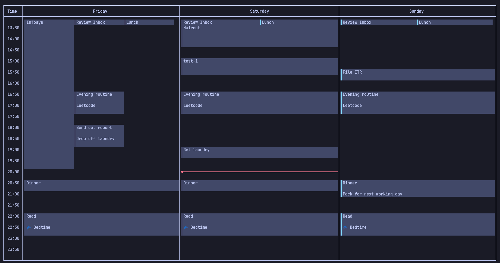

# 📅 GCAL TUI

A blazing fast, keyboard-driven Google Calendar terminal UI built with Rust and [Ratatui](https://github.com/ratatui/ratatui).



---

## ✨ Features

- **⚡ 5-Minute Grid Time-Blocking (`i` mode):** Interactive visual time-blocking directly on the calendar grid with single-keystroke adjustments (`h`/`j`/`k`/`l` to move, `J`/`K` to stretch duration).
- **🎨 Google Calendar Color Palette:** Full support for canonical Google Calendar event colors (Lavender, Sage, Grape, Flamingo, Banana, Tangerine, Peacock, Graphite, Blueberry, Basil, Tomato) with real-time preview and an interactive, keyboard-navigable dropdown.
- **🕒 12h / 24h Clock Toggle (`C` key):** Switch seamlessly between 12-hour (with AM/PM) and 24-hour time formats across gutters, time cursor, grid rules, event blocks, and popups.
- **📆 Multi-Calendar Support (`c` key):** Automatically synchronizes across all your Google Calendars (primary, secondary, and workspace) with automatic color matching and luminance-based high-contrast typography.
- **🚀 Dynamic Navigation & Scroll Acceleration:**
  - `gg` Jump to day start (00:00)
  - `G` Jump to day end (23:55)
  - `rn` or `t` Jump to right now (current time)
  - `j` / `k` Smooth vertical scrolling with dynamic hold acceleration
  - `J` / `K` 2-hour jump scrolling
  - `Ctrl-d` / `Ctrl-u` Half-page scrolling
- **📊 Adaptive Views:** Instant switching between 1-Day (`d`), 3-Day (`3` / `D`), and Week (`w`) modes.
- **⚡ 1-Key Time-Blocking Macros:**
  - `1`: 60m Deep Work block
  - `2`: 15m Standup block
  - `3`: 45m Lunch block
  - `4`: 30m Planning block
- **↩️ Undo Support (`u`):** Accidentally deleted an event? Press `u` in normal or visual mode to instantly restore it.
- **🛡️ Secure by Default:** Strictly least-privilege OAuth scope (`calendar.events`), secure permission masks (`0700` directories, `0600` files), and zero secrets committed to source control.

---

## 🚀 Quickstart & Installation

### Option 1: Automatic Setup via Makefile (Recommended)

Clone the repository and run the dynamic build & installation script:

```bash
git clone https://github.com/janjanbaj/gcal.git
cd gcal

# 1. Initialize environment & application directories
make setup

# 2. Configure your Google Cloud OAuth credentials in .env
# (See the "Google OAuth Setup" section below)
$EDITOR .env

# 3. Build optimized release binary & install to ~/.cargo/bin
make install
```

Once installed, simply run:
```bash
gcal
```

---

## 🔑 Google OAuth Credentials Setup

To connect to your Google Calendar without hardcoded or shared secrets, create your own free Google Cloud Desktop OAuth client:

1. Visit the [Google Cloud Console](https://console.cloud.google.com/).
2. Create a new project (e.g. `gcal-tui`).
3. Under **APIs & Services > Library**, search for and **Enable** the **Google Calendar API**.
4. Under **APIs & Services > OAuth consent screen**:
   - Choose **External** (or **Internal** if using Google Workspace).
   - Fill in the app name and your email.
   - Add scope: `https://www.googleapis.com/auth/calendar.events`.
   - Under **Test Users**, add your Google email address.
5. Under **APIs & Services > Credentials**:
   - Click **Create Credentials > OAuth client ID**.
   - Application type: **Desktop app**.
   - Copy the generated **Client ID** and **Client Secret**.
6. Paste them into your local `.env` file:
   ```env
   GCAL_CLIENT_ID="your_client_id.apps.googleusercontent.com"
   GCAL_CLIENT_SECRET="your_client_secret"
   ```

*On first launch, `gcal` will open your default browser to grant permission. The authenticated session token is saved securely with `0600` permissions into your system data directory (`tokencache.json`).*

---

## 🛠️ Makefile Targets

The included dynamic Makefile automatically discovers your platform (macOS/Linux), architecture, and Rust installation:

| Target | Description |
|---|---|
| `make` / `make all` | Checks dependencies, prepares directories, compiles release build, and installs `gcal`. |
| `make setup` | Creates `.env` template (if none exists) and initializes secure config directories. |
| `make build` | Compiles in debug mode. |
| `make release` | Compiles optimized release build (single codegen unit, Link-Time Optimization, stripped symbols). |
| `make install` | Installs release binary to `~/.cargo/bin/gcal` (or custom prefix). |
| `make uninstall` | Removes binary from `~/.cargo/bin/gcal`. |
| `make test` | Runs the full 25+ automated test suite. |
| `make lint` | Runs `cargo clippy --all-targets -- -D warnings`. |
| `make audit-secrets` | Verifies repository state to ensure no `.env` or credential files leak to git before pushing. |
| `make run` | Compiles release build and runs `gcal`. |
| `make clean` | Cleans target build artifacts. |

---

## ⌨️ Keybindings & Cheat Sheet

Press `?` at any time inside the app to toggle the live keybindings cheat sheet.

### Normal Mode (Navigation & Views)
| Key | Action |
|---|---|
| `h` / `l` | Move 1 day backward / forward |
| `j` / `k` | Scroll down / up (smooth acceleration when held) |
| `J` / `K` | Fast scroll (jump 2 hours down / up) |
| `Ctrl-d` / `Ctrl-u` | Scroll half page down / up |
| `Ctrl-f` / `Ctrl-b` | Scroll full page down / up |
| `gg` | Jump to top of day (00:00) |
| `G` (or `GG`) | Jump to bottom of day (23:55) |
| `rn` (or `t`) | Jump to current time |
| `T` | Toggle current time cursor line |
| `R` | Force refresh calendar events |
| `c` | Cycle active calendar |
| `C` | Toggle 12-hour / 24-hour clock format |
| `d` | 1-Day view |
| `3` (or `D`) | 3-Day view |
| `w` | Week view (7 days) |
| `1` | Macro: 60m Deep Work block |
| `2` | Macro: 15m Standup block |
| `3` | Macro: 45m Lunch block |
| `4` | Macro: 30m Planning block |
| `i` | Enter 5m Time-Blocking Mode |
| `v` | Enter Visual Event Selection Mode |
| `u` | Undo last deleted event |
| `q` / `Ctrl-c` | Quit |

### Time-Blocking Mode (`i`)
| Key | Action |
|---|---|
| `j` / `k` | Move block by 5 minutes |
| `J` / `K` | Expand / shrink block duration by 5 minutes |
| `h` / `l` | Move block by -1 / +1 day |
| `c` | Cycle time block color in real time |
| `Enter` | Open event details popup |
| `Esc` | Cancel time block |

### Event Details Popup
| Key | Action |
|---|---|
| `Tab` / `Shift-Tab` | Cycle between Summary, Description, Start Time, End Time, Calendar, and Color |
| `h` / `l` (on Calendar) | Select previous / next calendar |
| `h` / `l` (on Color) | Cycle event color |
| `Space` / `Enter` (on Color) | Open floating dropdown color menu (`j`/`k` to select, `Enter` to confirm) |
| `Enter` (on Summary) | Save and submit event |
| `Ctrl-s` | Save and submit event from any field |
| `Esc` | Cancel popup |

### Visual Mode (`v`)
| Key | Action |
|---|---|
| `j` / `k` | Select next / previous event |
| `+` / `-` | Shift selected event start/end by +/- 5 minutes |
| `J` / `K` | Resize selected event duration by +/- 5 minutes |
| `Enter` | Edit event details & color |
| `d` | Delete selected event (with confirmation) |
| `u` | Undo last deleted event |

---

## 🔒 Privacy & Security

- **Zero Telemetry:** No user analytics, metrics, or third-party pings.
- **No Credential Storage on Remote Repos:** API credentials are read from local environment variables or configuration files.
- **Pre-push Audit Hook:** Run `make audit-secrets` prior to git commits to automatically verify no credentials or cache files are staged.

---

## 📄 License

This project is licensed under the [MIT License](./LICENSE).
